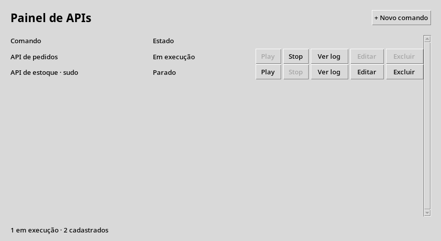
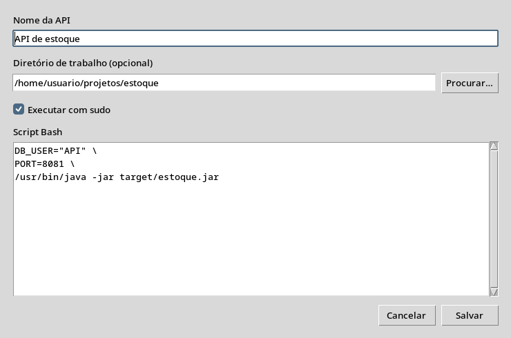
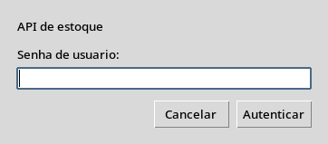
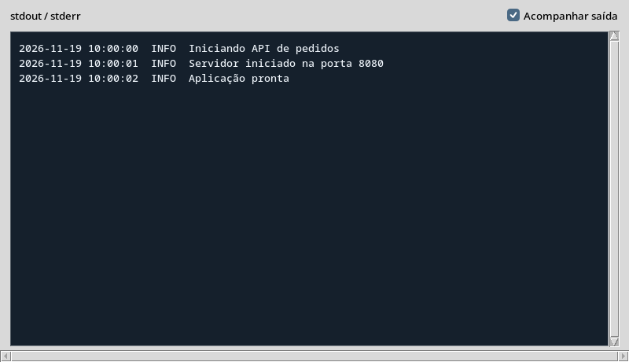

# Painel de APIs

Aplicativo desktop para executar e acompanhar comandos Bash no Linux.

## Instalação

Baixe o pacote da sua distribuição na seção **Assets** da release estável
mais recente. Os exemplos usam a versão `1.2.3`. Substitua pelo nome do
arquivo que você baixou e rode o comando na pasta onde ele está.
[Releases do Painel de APIs](https://github.com/felipelima94/shell-execute-control/releases/latest)

**Fedora**

```sh
sudo dnf install ./shell-execute-control-1.2.3-1.noarch.rpm
```

**Ubuntu e Debian**

```sh
sudo apt install ./shell-execute-control_1.2.3_all.deb
```

Abra **Painel de APIs** no menu de aplicativos ou execute
`shell-execute-control` no terminal.

Para atualizar, feche o painel, baixe o pacote da nova release e repita o
comando de instalação. Os cadastros e logs ficam na sua conta de usuário.

Para remover o aplicativo, use `sudo dnf remove shell-execute-control` no
Fedora ou `sudo apt remove shell-execute-control` no Ubuntu e Debian.

## Uso

### Painel principal



Cada linha mostra o nome e o estado do comando. **Play** inicia a execução,
**Stop** encerra e **Ver log** abre a saída. Use **Editar** para alterar o
cadastro e **Excluir** para removê-lo e apagar seu log. Durante a execução,
edição e exclusão ficam indisponíveis. O estado informa quando um comando
terminou ou falhou e exibe o código de saída.

Arraste a alça **⠿** na coluna **Ordem** e solte o comando onde a linha de
inserção aparecer. A lista rola ao aproximar o ponteiro das bordas superior
e inferior. A nova ordem é salva automaticamente. Pressione **Esc** para
cancelar o arraste.

### Cadastrar um comando



Clique em **Novo comando**, informe o nome da API e cole o script Bash
completo. O diretório de trabalho é opcional. Quando estiver vazio, a execução
começa na sua pasta pessoal. Marque **Executar com sudo** para executar o
script inteiro como root e clique em **Salvar**.

### Autenticar com sudo



Se o sudo solicitar autenticação ao clicar em **Play**, informe a senha da
conta indicada e clique em **Autenticar**. **Cancelar** interrompe a tentativa.
A política do sistema determina qual conta será solicitada.

### Acompanhar os logs



Clique em **Ver log** para consultar stdout e stderr juntos. Com
**Acompanhar saída** marcado, o visualizador acompanha as novas linhas. Ele
mostra até os últimos 256 KiB, enquanto o arquivo guarda toda a saída da
execução. O log permanece disponível após o encerramento e é substituído no
próximo **Play**.

Ao fechar o painel, todos os comandos ativos recebem um pedido de encerramento
ao mesmo tempo. Após cinco segundos, o painel força o encerramento dos grupos
que ainda estiverem ativos.

Os comandos rodam em segundo plano para o painel. Mantenha a API no grupo
de processos do script para que o painel consiga encerrá-la. Se a execução
terminar por conta própria, o painel mostra o resultado e aguarda outro Play.

Os scripts são gravados em `${XDG_CONFIG_HOME:-~/.config}/shell-execute-control/commands.json`.
O log da última execução de cada comando fica em
`${XDG_STATE_HOME:-~/.local/state}/shell-execute-control/`. Os arquivos de
cadastro e de log têm permissões privadas do usuário. O próximo Play substitui
o log anterior.

## Comandos com sudo

Marque **Executar com sudo** no cadastro para rodar todo o script como root.
Se o sudo pedir autenticação, o painel abre uma caixa de senha e mostra a
conta indicada. A política do sistema define se a senha é do seu usuário ou
do root. Digite a senha nessa caixa. O painel só a envia ao sudo pelo canal
de autenticação.

O sudo precisa autorizar o Python do sistema a iniciar o supervisor do painel.
Uma regra que autoriza apenas o binário Java pode rejeitar essa chamada. Se o
sudo recusar a execução, **Ver log** mostra o motivo e deixa disponível o log
da última execução. **Stop** e o fechamento do painel usam a autorização da
execução já iniciada.

## Desenvolvimento

Para rodar a partir do código-fonte, use Python 3.10 ou superior com Tkinter
e Bash em `/bin/bash`. Na pasta do projeto, execute `/usr/bin/python3 app.py`.
Para adicionar um atalho do checkout ao menu do seu usuário, execute
`/usr/bin/python3 install_launcher.py`. Execute o instalador do atalho
novamente se mover o checkout.

## Publicar uma release

No GitHub, publique uma release estável com uma tag no formato `vX.Y.Z`
apontando para o commit com o workflow e a versão do aplicativo desejada.
Acompanhe **Pacotes Linux** na aba **Actions**. Após a verificação no Fedora,
Ubuntu e Debian, os dois instaladores aparecem em **Assets** da release.
O envio exige que o repositório permita anexar arquivos após a publicação.
[GitHub Actions](https://github.com/felipelima94/shell-execute-control/actions/workflows/linux-release.yml)
